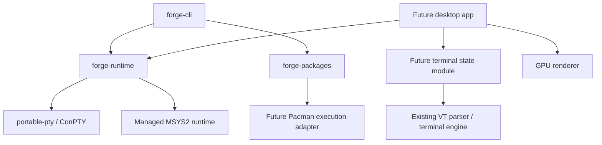

# Architecture

## Dependency direction

Nodes labeled future and desktop/terminal/PTY concepts are design targets, not implemented crates. Current crates
use Clap for CLI parsing and tempfile for filesystem tests. They have no graphics
or networking dependencies; runtime planning inspects a supplied MSYS2 root.

## Responsibility and locality

The CLI owns arguments and presentation. Runtime owns shell discovery, environment
construction, native process launch and session lifecycle. Packages owns catalog
validation and planning. No package code depends on CLI or terminal rendering.
The desktop app will compose these modules without putting package operations
inside the rendering loop. Runtime process I/O must remain off the UI thread.

Use small public interfaces with platform complexity behind them. Initially use
concrete modules, not trait layers with only one implementation. Introduce an
adapter seam when a second real backend or an external effect requires it.

## Runtime

Target Windows x86-64 first. A managed MSYS2 root supplies MSYS Bash/Zsh and POSIX
utilities. UCRT64 tools supply native Windows development executables. Use the
supported MSYS2 launcher/environment rules; verify interoperability with ConPTY
before committing to direct shell launch. PATH precedence, MSYSTEM, HOME, cwd,
locale and environment inheritance belong here. Preserve native argument types.
Do not pretend MSYS binaries and UCRT64 binaries have identical dependencies.

macOS/Linux are development hosts for planning and pure behavior, not substitutes
for a Windows runtime. Native Linux ELF or macOS Mach-O execution is out of scope.

## Terminal

First prove one child process, input/output, resize and clean shutdown through
WezTerm's portable-pty. Evaluate an existing terminal state engine (Alacritty's
library) independently of a GPU/native-window renderer. Avoid a new VT parser.
A renderer choice remains deferred until font shaping, IME, accessibility, DPI,
clipboard and native Windows chrome can be assessed through a working slice.

## Packages

A Forge command owns a curated name-to-package catalog and clear errors. Pacman
continues to own repository dependency solving and package transactions. Forge
must not assert reproducibility from package names alone: MSYS2 is rolling-release.
A later lock format needs exact artifacts, integrity digests and a retention
strategy. No unsupported promise to consume Homebrew bottles or arbitrary AUR
recipes. Start with planning; add execution only after failure behavior is tested.

## Distribution

Per-user runtime installation is the goal. Bootstrap requires integrity checking,
rollback, runtime update policy and license notices before redistribution. Keep
runtime mutable package state separate from immutable application releases.
A package update must not silently corrupt the running shell environment.

## Upstream evidence

- [WezTerm PTY interface](https://github.com/wezterm/wezterm/blob/main/pty/src/lib.rs): reusable cross-platform process hosting.
- [Alacritty workspace](https://github.com/alacritty/alacritty/blob/master/Cargo.toml): separate application and terminal-state library.
- [MSYS2 environments](https://www.msys2.org/docs/environments/): MSYS and UCRT64 have different purposes and toolchain/runtime characteristics.
- [MSYS2 package management](https://www.msys2.org/docs/package-management/): reuse Pacman's package transactions and dependency handling.
- [Microsoft ConPTY](https://learn.microsoft.com/en-us/windows/console/creating-a-pseudoconsole-session): Windows terminal process hosting.

These are architecture references, not vendored or copied source. Reassess license
and API compatibility before adding upstream implementation dependencies.
